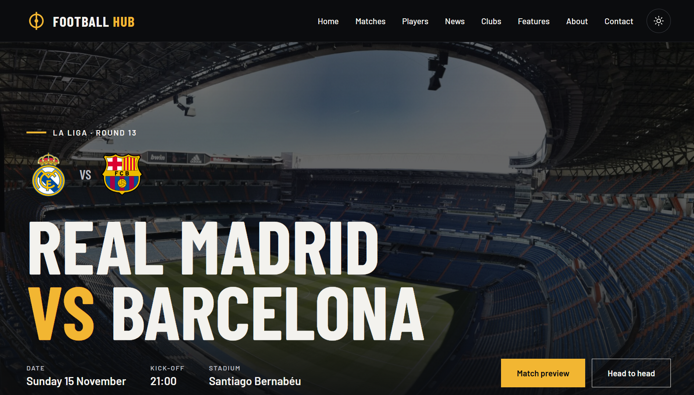
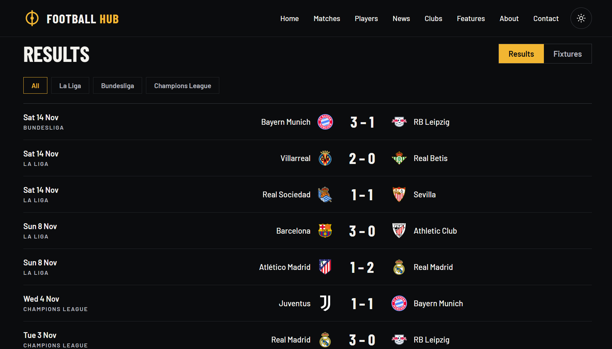
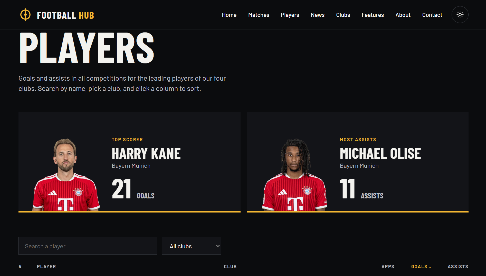

# Football Hub

A football website for CSCI426 (Advanced Web Programming), Project Phase 1.

Fans usually need one site for scores and another for club history and squads. Football Hub puts both in one place: scores, standings, player stats and news, next to full guides for Real Madrid, FC Barcelona, Bayern Munich and Juventus.

## Built with

- React 19 (Create React App)
- React Router
- Plain CSS, one file per component

## Run it locally

You need Node.js 20 or newer.

```bash
npm install
npm start
```

Then open http://localhost:3000.

To make a production build:

```bash
npm run build
```

## Project structure

```
src/
  App.js        routes and the dark/light theme
  pages/        one file per page
  components/   navbar, footer, hero, score item, club card, table, news
  styles/       one CSS file per component
  hooks/        useLocalStorage (saves the theme)
  data/         sample data: teams, clubs, matches, standings, news
  assets/       club crests and photos
```

## Status

The Home page and the four club pages (`/clubs/real-madrid`, `barcelona`, `bayern-munich`, `juventus`) are built. The other pages are added one at a time.

## Screenshots

### Home Page



### Matches Page



### Players Page



## Credits

Image and font credits are listed on the About page. Scores, standings and news are sample data written for this project.
